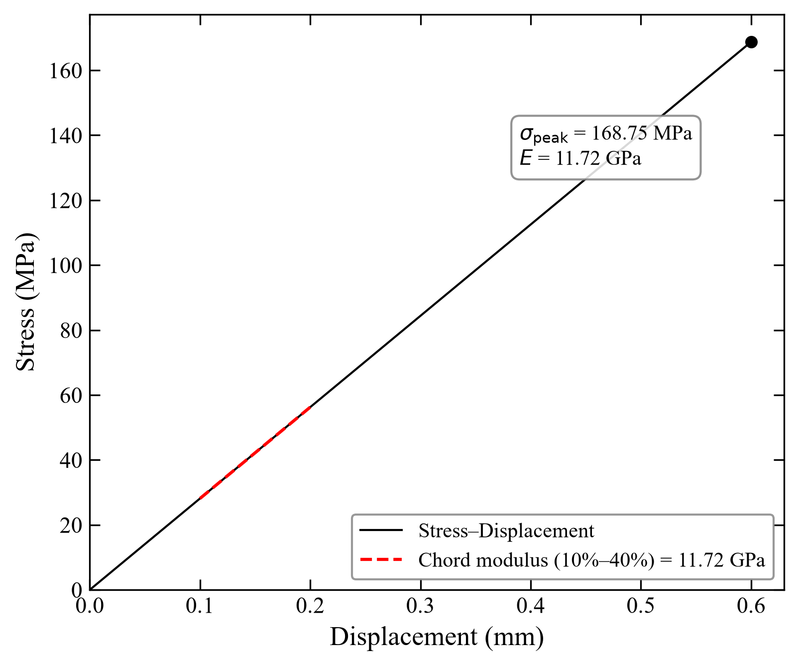

# clean_number

Turn supported testing-machine exports into peak-stress summaries, diagnostic
moduli, plots and traceable processing records.

**Release candidate:** `v0.2.0-rc.1` · **License:** [MIT](LICENSE)

**Verified environment:** Windows, Python 3.14.2

`clean_number` is a Python command-line tool for researchers processing
compression and rectangular three-point-bending data. It keeps the source
files unchanged and records the inputs, configuration and outputs for each run.

## What it supports

| Method | Required measurements | Calculated output |
| --- | --- | --- |
| Compression | Supplied stress in MPa and strain in % | Peak supplied stress and a configurable diagnostic chord modulus |
| Rectangular three-point bending | Force in kN and displacement in mm | Recalculated nominal flexural stress and a diagnostic flexural modulus when available |

- Explicit input, method, configuration and output directories.
- Configurable bending geometry and chord intervals in `experiment.yaml`.
- Per-file results, independent-specimen grouping, statistics tables and plots.
- Duplicate-content markers and recorded, file-specific processing overrides.
- A processing manifest that binds inputs, configuration and outputs with hashes.

The calculations do not establish standards compliance or material validity.
Supported column labels, units and geometry are deliberately limited; see the
[support matrix](SUPPORT_MATRIX.md) before using your own data.

## Example output



*Generated synthetic data, not experimental measurements.* This example uses
the configured beam geometry and reports a nominal peak stress of 168.75 MPa
and a diagnostic modulus of 11.72 GPa. The synthetic values exercise the
calculation; they are not a material-property claim.

## Quick start

From a local checkout, create an environment and install the core dependencies.
The following commands use Windows PowerShell and do not require activation:

```powershell
python -m venv .venv
& .\.venv\Scripts\python.exe -m pip install -r requirements.txt
```

Run the included synthetic compression example:

```powershell
& .\.venv\Scripts\python.exe analyze.py `
  --dir examples/synthetic/input/compression `
  --config examples/synthetic/experiment.yaml `
  --kind compression `
  --output run-output/compression `
  --phase2-only
```

Run the synthetic three-point-bending example:

```powershell
& .\.venv\Scripts\python.exe analyze.py `
  --dir examples/synthetic/input/flexural `
  --config examples/synthetic/experiment.yaml `
  --kind flexural `
  --output run-output/flexural `
  --phase2-only
```

`--phase2-only` skips optional document report export. Add `--no-plot` if you
only need tables and processing records. Choose a new output directory for
each run; a non-empty directory is rejected unless you explicitly pass
`--overwrite`.

The bundled fixtures are GBK-encoded tab-separated text with an `.xls` suffix,
one metadata row and then the column headers. They are generated from simple
numerical curves; see [the synthetic example](examples/synthetic/README.md).
Excel workbooks have a separate reader path, with the required engines listed
in `requirements.txt`.

### Expected results

Selected per-file values from the included examples:

| Method | Fixture | Peak stress (MPa) | Diagnostic modulus (GPa) |
| --- | --- | ---: | ---: |
| Compression | `d28control1-1.xls` | 60.0 | 10.0 |
| Flexural | `d28treated1.xls` | 168.75 | 11.71875 |

Each output directory contains:

```text
run-output/flexural/
├── summary.csv                 # Per-file values and processing status
├── figures/                    # Curves and group/statistics plots
├── tables/                     # Analysis units and statistics tables
├── experiment_manifest.yaml    # Configuration snapshot
├── experiment_manifest.sha256  # Snapshot hash
└── processing_manifest.json    # Input/configuration/output references and hashes
```

A failed input remains visible in the processing records and makes the CLI
exit non-zero. A missing diagnostic modulus can coexist with a valid peak
stress and file status `ok`; check the individual result fields. Run status
is a processing result, not scientific acceptance.

## Use your own data

1. Start with [the example configuration](examples/synthetic/experiment.yaml).
   Set the condition mapping, grouping and method parameters for your experiment.
2. Match the supported measurement names, units and filename conventions.
   For example, compression files use `d{age}{condition}{specimen}-{end}`.
   Parsing currently uses Chinese measurement labels such as `应力 (MPa)` and
   `应变 (%)`; internal field names are not universal input-header aliases.
3. Select `--kind compression` or `--kind flexural`, pass `--config`, and
   choose an explicit output directory.
4. Review individual curves, missing values, exclusions and analysis-unit
   grouping before interpreting summary statistics.

Unknown conditions, missing required columns, unsupported units and duplicate
semantic columns are rejected. Raw input files are not rewritten. Optional
`processing_overrides.yaml` rules record file-specific truncation or exclusion;
duplicate content is marked rather than silently deleted.

## Method boundaries

The default chord interval is 10%–40% of the recorded peak. It is a diagnostic
software convention, not an implementation of a complete standardized test.
Compression relies on the supplied instrument stress and strain channels.
Bending assumes the configured rectangular section and central point loading.

A displacement column labelled mm does not prove that it measures specimen
mid-span deflection; machine compliance, shear deflection and support effects
are not corrected. The generated example geometry is for arithmetic checks.
An unavailable flexural modulus stays missing rather than being replaced with
a stress/strain calculation using displacement.

See [method derivations and reviewed sources](METHOD_VALIDATION.md) for the
mechanics basis, standards differences and measurement assumptions. Other
geometries, test methods and instrument conventions need separate validation.

## Verification and integration

Run the self-contained synthetic test suite:

```powershell
& .\.venv\Scripts\python.exe -m unittest discover -s tests -v
```

The 12 tests cover numerical checks, geometry changes, invalid columns/units,
input preservation, grouping, output containment and unavailable flexural
modulus handling. Installation and both example commands were verified on
Windows with Python 3.14.2. Dependency lower bounds are not a tested platform
or Python-version matrix. See [TESTING.md](TESTING.md) for the verification scope.

The tool runs independently. Its processing manifests can also be inspected
and registered by the separate mining-research-kernel adapter. That adapter
has historical integration evidence; the core examples and tests do not
require the kernel or private experiment data.

Optional DOCX/PDF export uses `requirements-report.txt` and is outside the
validated workflow for this release candidate.

## Documentation and license

- [Supported inputs and explicit non-support cases](SUPPORT_MATRIX.md)
- [Method review and formula references](METHOD_VALIDATION.md)
- [Verification instructions](TESTING.md)
- [Release notes](RELEASE_NOTES.md)
- [Source provenance](PROVENANCE.md)
- [Third-party dependency notices](THIRD_PARTY_NOTICES.md)

Licensed under the [MIT License](LICENSE). Dependencies retain their own
licenses. Public examples and the preview image are synthetic; private
experimental data, formulations and reports are not included.
